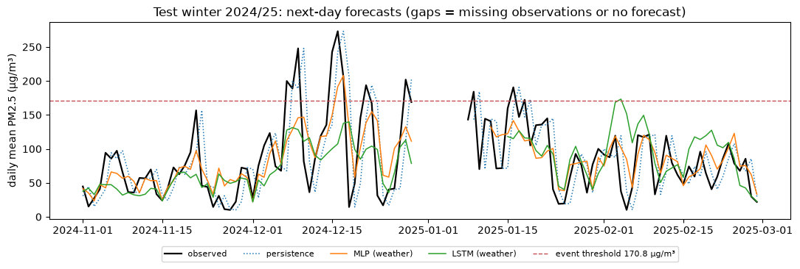
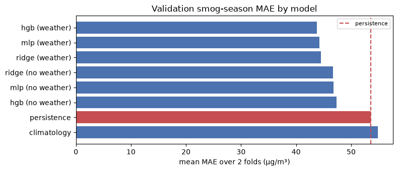
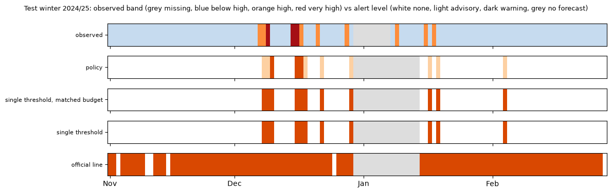
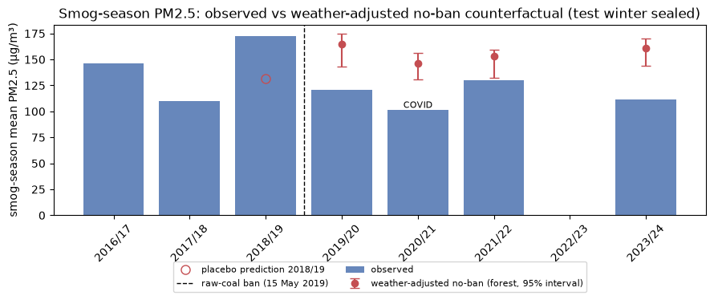
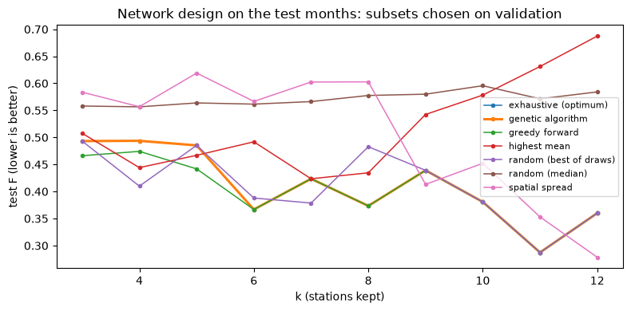

# Ulaanbaatar winter PM2.5: day-ahead warnings, the coal-ban effect and a leaner monitoring network

BSHDS4 Neural Networks & Prescriptive Analytics, National College of Ireland.
How can neural-network forecasting and optimisation support action against Ulaanbaatar's winter PM2.5?
The project forecasts next-day PM2.5 at the US Embassy monitor and turns it into a fatigue-aware warning policy,
estimates what the 15 May 2019 raw-coal ban achieved once weather is removed, and uses a genetic algorithm to decide
how few stations of the new official monitoring network are needed.

## Results (scored once on the sealed test data)

| | Hypothesis | Verdict | Key number |
|---|---|---|---|
| H1 | The selected neural network (MLP) beats persistence | **Supported** | skill +0.189; MAE −6.9 µg/m³ (95% CI −10.7 to −3.3) |
| H2 | Weather features improve the neural network | **Supported** (small) | MLP MAE −0.52 µg/m³ with weather (ridge +0.88, boosting −0.90, LSTM +8.54) |
| H3 | GA station subsets beat random, highest-mean, spatial spread and match greedy | Not supported | GA wins at 5 of 10 network sizes |
| H4 | The GA finds the exhaustive optimum (within 2%) | **Supported** | 10 of 10 network sizes (validation) |
| H5 | The fatigue-aware policy catches more unhealthy days per alert | Not supported | 0.36 vs 0.36 at a matched alert budget |
| H6 | Weather-adjusted winter PM2.5 fell after the ban | Inconclusive | placebo +31.4% (rule ±15%); pooled effect −25.2% (−28.9 to −15.0) |

Sources: `outputs/results/test_summary.json` and `ban_effect.json`. Test winter 2024/25 (forecasting, warnings);
test months Feb–Mar 2026 (network).

## Results in detail

Figures are copied unchanged from the notebooks' saved outputs (`docs/figures/`).

### 1 · Next-day forecasts on the test winter 2024/25 (H1, H2)



| Model | Days | MAE (µg/m³) | Skill vs persistence | Unhealthy days caught | Worst-10% bias (µg/m³) |
|---|---|---|---|---|---|
| Persistence (tomorrow = today) | 107 | 36.3 | +0.00 | 4 of 10 | −37 |
| Climatology | 107 | 46.1 | −0.27 | 0 of 10 | −63 |
| Ridge (weather) | 107 | 30.2 | +0.17 | 2 of 10 | −73 |
| Gradient boosting (weather) | 107 | 31.4 | +0.14 | 3 of 10 | −64 |
| **MLP (weather), selected** | 107 | **29.5** | **+0.19** | 2 of 10 | −65 |
| LSTM (weather) | 104 | 37.9 | −0.04 | 0 of 10 | −94 |

The MLP chosen on validation cut persistence's error by 19%, with ridge and boosting close behind; the LSTM did not
beat persistence. Every model underpredicts the worst days, so few of the 10 unhealthy days (> 170.8 µg/m³) are
forecast above the line: persistence catches the most.

### 2 · How the models were chosen (validation, two rolling folds)



On validation, weather features helped every model family, and boosting, MLP and ridge finished within
0.7 µg/m³ of each other; the MLP was carried forward as the selected neural network.

### 3 · Day-ahead warnings on the test winter (H5)



| Rule (same forecast, 111 test days) | Alerts | Unhealthy days caught | Caught per alert | Longest warning run |
|---|---|---|---|---|
| Fatigue-aware policy (advisory 170 / warning 210) | 11 (8 advisories, 3 warnings) | 4 of 11 | 0.36 | 2 days |
| Single threshold, same alert budget | 11 | 4 of 11 | 0.36 | 3 days |
| Official 24-h line (37.5 µg/m³) | 98 | 10 of 11 | 0.10 | 44 days |

The policy catches exactly as many unhealthy days per alert as a single threshold with the same budget, so H5 is not
supported; it does spread its alerts over two levels and never warns more than two days in a row. The official line
alerts on 98 of 111 days, which is why a single official-line alert fails in Ulaanbaatar.

### 4 · What the 2019 raw-coal ban achieved, weather-adjusted (H6)



| Winter | Observed (µg/m³) | Weather-adjusted no-ban (µg/m³) | Effect (95% interval) |
|---|---|---|---|
| 2019/20 | 121 | 165 | −27% (−31% to −16%) |
| 2020/21 (COVID) | 101 | 146 | −31% (−35% to −22%) |
| 2021/22 | 130 | 153 | −15% (−19% to −2%) |
| 2023/24 | 112 | 161 | −31% (−34% to −22%) |
| Pooled | 118 | 157 | −25% (−29% to −15%) |

After the ban, winters were 15–31% cleaner than their weather predicts. But the same model "finds" a +31% effect in
2018/19, a winter with no ban (the placebo), so under the rule fixed in advance H6 is inconclusive. The estimate is
weather-adjusted, not causal.

### 5 · How few monitoring stations are needed (H3, H4)



Lower F means the kept stations reconstruct the dropped ones better. The GA found the exhaustive optimum at every
network size on validation (H4). On the test months its subsets beat random, highest-mean and spatial-spread choices
at 5 of 10 sizes (k = 6, 7, 8, 10, 11; e.g. keeping 6 of 13 stations: F 0.367 vs 0.562 for a random median), tying
greedy there; greedy is better at k = 3–5 and spatial spread at k = 9 and 12, so H3 is not supported.

## Repository map

```
configs/study_config.yaml       every date, threshold, grid and rule (frozen)
src/uaq/                        all logic; notebooks only call it
notebooks/                      six notebooks, run in order 1 → 6
tests/                          offline pytest suite
outputs/results/                validation and test results, test-run log
outputs/audit_forecast|network/ audit reports and figures
docs/data_source_register.csv   sources, licences, attribution
data/raw/                       downloads (git-ignored, never committed)
dev/                            synthetic-data generator for dry runs
```

| Notebook | Contents |
|---|---|
| `1_data_preparation` | Forecasting data audit (8160), network data audit (agaar), ERA5 weather and the feature table |
| `2_forecasting_models` | Baselines, ridge, boosting, MLP and LSTM selected on two rolling validation folds; weather ablation |
| `3_warning_policy` | Two-level warning policy with fatigue rule and alert budgets, chosen on validation |
| `4_coal_ban_effect` | Weather-normalised counterfactual (random forest, linear and dummy-regression cross-checks), placebo |
| `5_network_design_ga` | GA vs exhaustive, greedy, random, highest-mean and spatial-spread station subsets |
| `6_final_test_results` | The single test run: H1–H5 verdicts, test-winter figures, network test months |

| Old numbers | 01, 02, 04 | 05, 06 | 08 | 07 | 03 | 09 |
|---|---|---|---|---|---|---|
| Now | 1_data_preparation | 2_forecasting_models | 3 | 4 | 5 | 6 |

Comments in `src/` and `configs/` use the old numbers and were left unchanged so the hashes in
`outputs/results/test_run_log.json` still match.

## Reproduce (macOS)

```bash
conda create -n neural python=3.12 && conda activate neural
pip install -r requirements.txt && pip install -e . && pytest -q
brew install awscli    # OpenAQ station 8160
aws s3 cp --no-sign-request --region us-east-1 \
  s3://openaq-data-archive/records/csv.gz/locationid=8160/ data/raw/pm25/openaq/8160/ --recursive
git clone --depth 1 https://github.com/American-University-of-Mongolia/data-mn ../data-mn   # agaar archive
mkdir -p data/raw/agaar && cp -R ../data-mn/tools/sources/agaar/raw/ data/raw/agaar/
python -m uaq.weather  # hourly ERA5 from Open-Meteo (notebook 1 also downloads it if missing)
```

Run the notebooks in order 1 → 5. Notebook 6 refuses to run again: the test run is final and logged.

## Integrity

- Chronological splits: train winters 2019/20–2022/23, validation 2023/24 (two rolling folds), test 2024/25;
  every rule was fixed in the config before modelling, on availability, never on scores.
- The test data were sealed and scored once, at tag `test-run`, from code frozen at tag `pre-test-v2`; the run checks
  that no frozen file changed and logs SHA-256 hashes (`outputs/results/test_run_log.json`).
- Disclosed process notes: (1) an early data-audit figure showed the 2024/25 smog-season mean; it was corrected and
  no modelling choice used it; (2) the warning policy was revised on validation before the test (advisories had no
  budget; tags `pre-test` → `pre-test-v2`).

## Data sources and licences

| Source | Used for | Licence / terms |
|---|---|---|
| OpenAQ location 8160 (AirNow, US Diplomatic Post) | forecasting, warnings, coal ban | US Public Domain |
| agaar.gov.mn (NAMEM) via the data-mn archive | network design | no published data terms: academic use with attribution, not redistributed (repo code MIT) |
| ERA5 via Open-Meteo | weather features | attribution: Open-Meteo (Zippenfenig, 2023); ERA5, Copernicus Climate Change Service |
| NSO Mongolia monthly tables | optional cross-check | CC BY 4.0 |

Details and attribution text: `docs/data_source_register.csv`.
